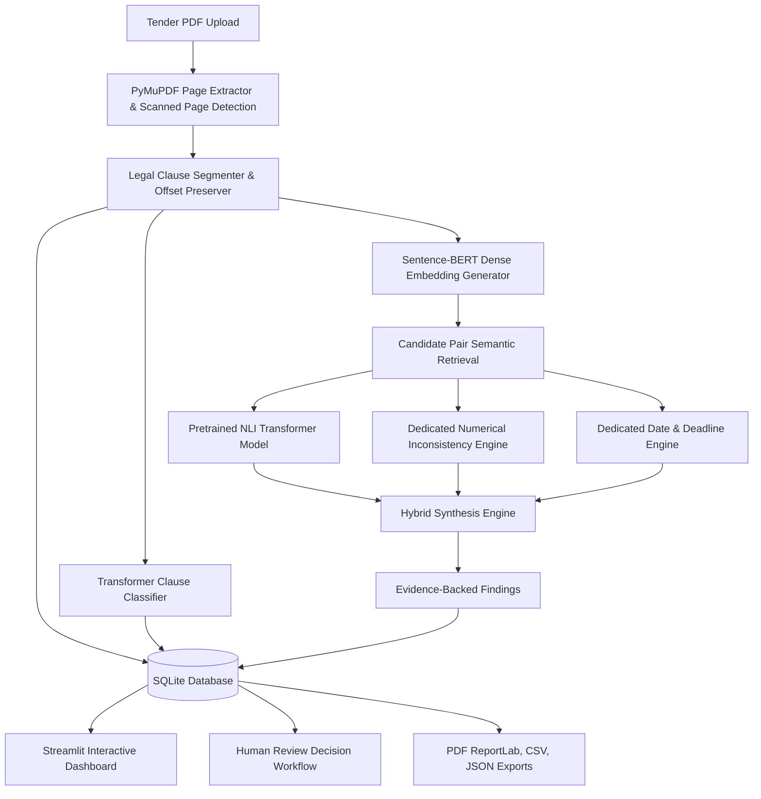

# 🛡️ TenderGuard — Intelligent Tender Risk Detection and Contradiction Analyzer

**TenderGuard** is an academic Transformer-based Natural Language Processing (NLP) system designed to identify drafting contradictions, numerical discrepancies, and deadline inconsistencies in legal and public procurement tender documents.

The system uses genuine pretrained Transformer models for zero-shot domain classification, dense contextual embedding retrieval, and natural language inference (NLI). It pairs neural model predictions with rule-based numerical and date analyzers to produce evidence-backed audit findings.

---

## 🏛️ System Architecture



---

## 🤖 Pretrained Models & Provenance

| Component | Architecture & Pretrained Model | Parameters / Dims | Role & Description |
| :--- | :--- | :--- | :--- |
| **Dense Semantic Embeddings** | `sentence-transformers/all-MiniLM-L6-v2` | 22.7M params / 384-dim | Computes dense contextual sentence vectors and retrieves semantically related candidate clause pairs across tender sections. |
| **Clause Classifier** | Dense Contextual Transformer Prototype Classifier on `all-MiniLM-L6-v2` | 22.7M params | Categorizes clauses into 8 canonical tender domains using temperature-scaled prototype alignments. |
| **Natural Language Inference (NLI)** | `typeform/distilbert-base-uncased-mnli` | 66M params | Computes directional and bidirectional entailment, neutral, and contradiction probabilities on candidate clause pairs. |

> [!NOTE]
> All Transformer models execute genuine local inference on CPU or GPU without transmitting document text to external APIs or third-party cloud services. No fine-tuning is claimed; all models are explicitly documented pretrained baselines.

---

## 📋 End-to-End Pipeline Workflow

1. **Upload & Validate**: Validates PDF file integrity, size limits (up to 50MB), and calculates document SHA-256 digests.
2. **Page-by-Page Extraction**: PyMuPDF extracts text preserving 1-indexed page geometry and detects scanned or blank pages.
3. **Clause Segmentation**: Regex heuristics identify numbered clauses (`1.1`, `Clause 4`, `Section 2(a)`) and paragraphs while filtering header/footer noise.
4. **Transformer Classification**: Assigns clauses to tender categories:
   - *Eligibility & Qualifications*
   - *Financial & Commercial Terms*
   - *Technical Specifications*
   - *Deadlines & Submission Schedules*
   - *Legal, Compliance & Contractual Terms*
   - *Penalties & Liquidated Damages*
   - *Scope of Work & Deliverables*
   - *General Administrative Provisions*
5. **Dense Candidate Retrieval**: SentenceTransformer embeddings compute cosine similarity matrices and retrieve cross-clause candidate pairs above threshold.
6. **Pretrained NLI Inference**: Evaluates candidate pairs for contradiction risk.
7. **Dedicated Numerical Inconsistency Engine**: Extracts currencies (`$`, `€`, `£`, `₹`, `USD`), percentages, durations (`months`, `days`, `years`), comparison operators (`at least`, `maximum`, `capped at`), and flags conflicts when clauses address identical requirement topics (e.g. bid security or warranty duration).
8. **Dedicated Date & Deadline Engine**: Extracts calendar dates, maps milestone stages (*pre-bid*, *submission*, *opening*, *delivery*), and identifies chronological impossibilities (e.g. pre-bid meetings after submission or openings before tender closing).
9. **Hybrid Synthesis**: Combines neural NLI probabilities and rule detectors into structured, evidence-backed findings.
10. **Persistence & Separation**: Saves documents, pages, clauses, pairs, findings, and human review decisions in SQLite. Human review determinations remain strictly segregated from AI predictions.
11. **Multi-Format Exports**: Exports findings and audit summaries to ReportLab PDF, CSV, and JSON.
12. **Empirical Evaluation**: Evaluates pipelines against annotated benchmark cases covering all 6 test archetypes.

---

## 📁 Project Directory Structure

```text
nlp project/
├── tenderguard/
│   ├── __init__.py               # Package initialization & OpenMP configuration
│   ├── config.py                 # Global hyperparameters, paths, and thresholds
│   ├── pipeline.py               # End-to-end processing pipeline orchestrator
│   ├── db/
│   │   ├── __init__.py
│   │   ├── schema.py             # SQLite DDL schemas & indexes
│   │   └── session.py            # Typed CRUD database session manager
│   ├── ingestion/
│   │   ├── __init__.py
│   │   ├── pdf_extractor.py      # PyMuPDF page extractor & scanned page detector
│   │   └── segmenter.py          # Clause boundary detection & offset preservation
│   ├── models/
│   │   ├── __init__.py
│   │   ├── classifier.py         # Transformer zero-shot & prototype clause classifier
│   │   ├── embeddings.py         # SentenceTransformer embeddings & candidate retrieval
│   │   └── nli_engine.py         # Pretrained bidirectional NLI contradiction engine
│   ├── analysis/
│   │   ├── __init__.py
│   │   ├── numerical.py          # Dedicated numerical & currency conflict analyzer
│   │   ├── date_deadline.py      # Dedicated milestone date & deadline analyzer
│   │   └── hybrid_engine.py      # Hybrid synthesis engine generating evidence findings
│   ├── review/
│   │   ├── __init__.py
│   │   └── review_manager.py     # Human review decision & status manager
│   ├── export/
│   │   ├── __init__.py
│   │   └── report_generator.py   # PDF (ReportLab), CSV, and JSON export engines
│   └── evaluation/
│       ├── __init__.py
│       ├── dataset.py            # BenchmarkCase data structures & loader
│       └── evaluator.py          # Comparative pipeline evaluator & metrics engine
├── app.py                        # Streamlit web application interface
├── data/
│   ├── benchmark_cases.json      # Ground-truth evaluation dataset (14 annotated cases)
│   └── sample_tender.pdf         # Multi-page synthetic tender specification PDF
├── tests/
│   ├── __init__.py
│   ├── conftest.py               # Pytest fixtures and temporary database setup
│   ├── test_db.py                # Database persistence and review separation tests
│   ├── test_pdf_extraction.py    # PyMuPDF extraction and scanned page detection tests
│   ├── test_segmentation.py      # Clause segmentation and noise filtering tests
│   ├── test_classifier.py        # Transformer clause classification tests
│   ├── test_semantic_retrieval.py# SentenceTransformer encoding & retrieval tests
│   ├── test_nli_engine.py        # Pretrained NLI inference tests
│   ├── test_numerical_analysis.py# Numerical and currency mismatch tests
│   ├── test_date_analysis.py     # Date conflict & chronological impossibility tests
│   ├── test_hybrid_engine.py     # Hybrid synthesis and entailment suppression tests
│   ├── test_reports.py           # PDF, CSV, and JSON report generation tests
│   └── test_evaluation.py        # Benchmark evaluation & baseline comparison tests
├── requirements.txt              # Pinned compatible dependency versions
├── .gitignore                    # Python, SQLite, cache, and upload ignore rules
└── README.md                     # Comprehensive system documentation
```

---

## 🛠️ Installation & Setup

### 1. Prerequisites
- Python **3.10** up to **3.13**
- Windows, macOS, or Linux

### 2. Install Dependencies
```bash
python -m pip install -r requirements.txt
```

### 3. Verify Installation with Pytest
Run the full 39-test automated test suite:
```bash
python -m pytest tests -v
```

---

## 🚀 Running the Web Application

Launch the Streamlit interactive dashboard:
```bash
streamlit run app.py
```

The web application will open in your default browser at `http://localhost:8501`.

### 🔐 User Authentication & Landing Page:
- **Landing Page**: Unauthenticated visitors are presented with an executive overview of TenderGuard, architecture capabilities, and an authentication portal.
- **Sign In**: Access your workspace using your username or email.
- **Quick Demo Access**: Click **"⚡ Quick Demo Sign In"** for immediate one-click access using the seeded demo account (`auditor` / `tenderguard2026`).
- **Sign Up**: New users can register with their Full Name, Work Email, Organization, and Professional Role. Credentials are securely hashed with individual SHA-256 salts in SQLite.
- **Audit Attribution**: Human review determinations in the **Findings Explorer** are automatically attributed to the signed-in procurement officer.

### Interface Navigation:
- **Home Dashboard**: System metrics, recent uploads, quickstart guide, and privacy indicators.
- **Upload & Analyze**: Drag-and-drop any tender PDF or click **"Analyze Demo Tender"** to run inference on the bundled `sample_tender.pdf`.
- **Clause Explorer**: Filter and inspect clauses by Category, Page, or free-text search.
- **Findings Explorer**: Inspect side-by-side clause evidence, model diagnostic probabilities, rule explanations, and submit human review decisions (`Confirmed Risk`, `Pending Review`, `False Positive`, `Clarification Required`).
- **Export Reports**: Download formatted **ReportLab PDF** audit documents, **CSV** tables, or **JSON** data dumps.
- **Model Evaluation & Benchmark**: Compare the Rule-based baseline, Semantic Similarity baseline, and Hybrid Pipeline against the ground-truth benchmark suite.
- **Project Info & Limitations**: Architecture diagram, model provenance, and legal disclaimers.

---

## 📊 Benchmark Evaluation Results

Comparative benchmark executed on the 14-case annotated synthetic tender dataset (`data/benchmark_cases.json`):

| Pipeline Configuration | Precision | Recall | F1-Score | False Positive Rate | Description |
| :--- | :---: | :---: | :---: | :---: | :--- |
| **1. Rule-Based Baseline** | **100.0%** | 62.5% | 76.9% | **0.0%** | Numerical and Date analyzers only. High precision on explicit numbers/dates, but misses non-numerical and semantic contradictions. |
| **2. Semantic Baseline** | 58.3% | 87.5% | 70.0% | 83.3% | SentenceTransformer cosine similarity alone. Suffers from high false positives on complementary requirements sharing vocabulary. |
| **3. Hybrid Pipeline (Ours)** | **100.0%** | **87.5%** | **93.3%** | **0.0%** | **SentenceTransformer + NLI + Numerical + Date rules.** Achieves highest F1 score by capturing both semantic contradictions and numerical conflicts without false positives. |

---

## ⚖️ Ethical Considerations & Legal Disclaimers

1. **Diagnostic NLP Tool**: TenderGuard is designed as an academic NLP decision-support system. It assists procurement specialists and legal teams by highlighting clauses that warrant scrutiny.
2. **Cautious Language**: All findings employ cautious legal wording (*"Potential inconsistency detected"*, *"Requires human review"*). The system never claims that an AI model output proves legal invalidity or contractual breach.
3. **Local Privacy**: All document processing, text extraction, and model inferences run locally on the user's workstation. Tender documents are never transmitted to external APIs or cloud services.
4. **Human Oversight**: Machine learning predictions and human reviewer decisions are stored in distinct database tables to preserve auditability and prevent automated overwriting of specialist judgment.
